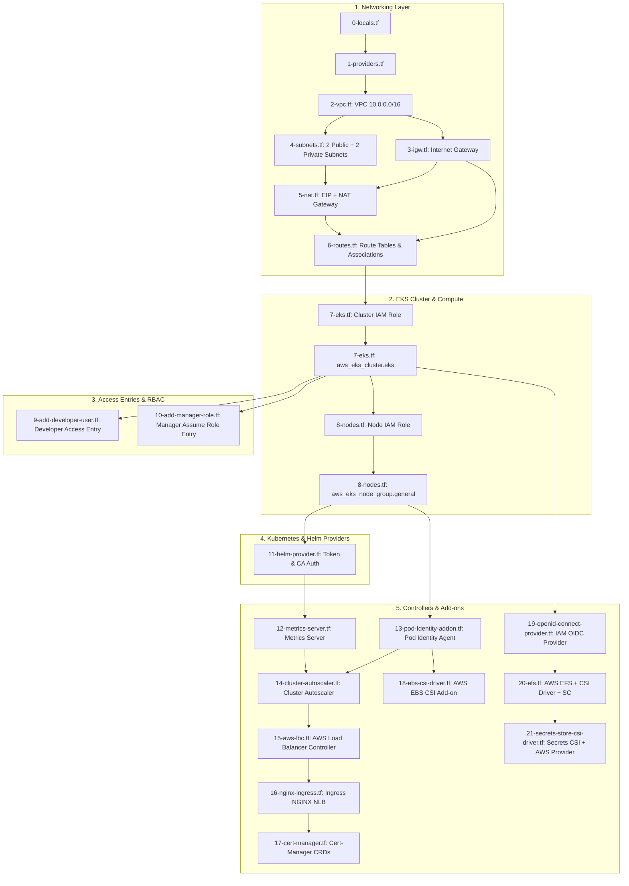
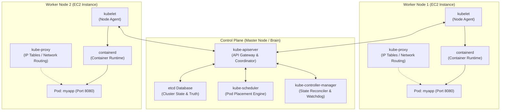
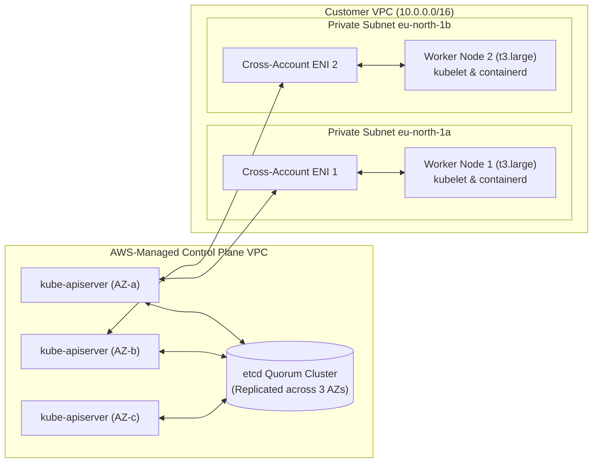
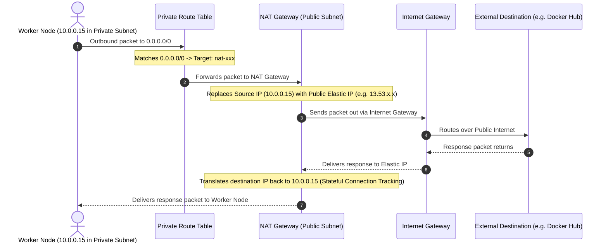
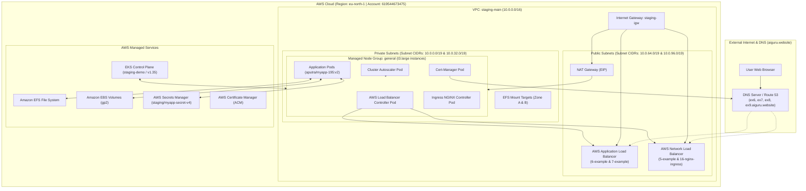

# Complete Kubernetes and Amazon EKS Training Course
## Real-World Production Implementation Based on `github.com/sangeethanayak521/k8s`

---

### Executive Overview & Project Environment
- **GitHub Repository:** [sangeethanayak521/k8s](https://github.com/sangeethanayak521/k8s)
- **AWS Region:** `eu-north-1` (Stockholm)
- **Primary Availability Zones:** `eu-north-1a`, `eu-north-1b`
- **AWS Account ID:** `619544673475`
- **EKS Cluster Name:** `staging-demo`
- **Kubernetes Version:** `1.35`
- **Production Domain:** `aiguru.website`
- **VPC CIDR:** `10.0.0.0/16`
- **Subnet Layout:**
  - Private Zone 1: `10.0.0.0/19` (`eu-north-1a`)
  - Private Zone 2: `10.0.32.0/19` (`eu-north-1b`)
  - Public Zone 1: `10.0.64.0/19` (`eu-north-1a`)
  - Public Zone 2: `10.0.96.0/19` (`eu-north-1b`)

---

# TABLE OF CONTENTS
1. [PART 1 – Understand the Complete Project](#part-1--understand-the-complete-project)
2. [PART 2 – Kubernetes Fundamentals for Beginners](#part-2--kubernetes-fundamentals-for-beginners)
3. [PART 3 – Introduction to Amazon EKS](#part-3--introduction-to-amazon-eks)
4. [PART 4 – Complete Terraform Implementation (File-by-File)](#part-4--complete-terraform-implementation-file-by-file)
5. [PART 5 – Complete AWS Networking Architecture](#part-5--complete-aws-networking-architecture)
6. [PART 6 – EKS Creation and Worker Node Registration](#part-6--eks-creation-and-worker-node-registration)
7. [PART 7 – IAM, Authentication and Authorization](#part-7--iam-authentication-and-authorization)
8. [PART 8 – Every EKS Add-On and Supporting Component](#part-8--every-eks-add-on-and-supporting-component)
9. [PART 9 – All 12 Practical Examples](#part-9--all-12-practical-examples)
10. [PART 10 – Complete Domain, DNS and SSL Architecture](#part-10--complete-domain-dns-and-ssl-architecture)
11. [PART 11 – Complete Architecture Diagrams (15 Diagrams)](#part-11--complete-architecture-diagrams)
12. [PART 12 – Complete Troubleshooting Field Guide](#part-12--complete-troubleshooting-field-guide)
13. [PART 13 – Complete Project Execution & Validation Guide](#part-13--complete-project-execution--validation-guide)

---

# PART 1 – Understand the Complete Project

This project builds a battle-tested, enterprise-grade Kubernetes cluster on Amazon Web Services (AWS) using **Infrastructure as Code (IaC)** with HashiCorp Terraform, Helm, and native Kubernetes manifests.

### 1.1 Complete Repository Structure
```text
k8s/
├── 0-locals.tf                          # Global environment variables and constants
├── 1-providers.tf                       # AWS, Helm, Kubernetes, TLS provider configurations
├── 2-vpc.tf                             # Custom Virtual Private Cloud (10.0.0.0/16)
├── 3-igw.tf                             # Internet Gateway for public internet access
├── 4-subnets.tf                         # 2 Public and 2 Private subnets across 2 AZs
├── 5-nat.tf                             # Elastic IP and NAT Gateway for private egress
├── 6-routes.tf                          # Public and Private route tables and subnet associations
├── 7-eks.tf                             # EKS Cluster, IAM Cluster Role, and Access Config
├── 8-nodes.tf                           # Managed Node Group, EC2 IAM Role, Scaling configuration
├── 9-add-developer-user.tf              # Developer IAM user, policy, and EKS access entry
├── 10-add-manager-role.tf               # Manager IAM user, assume-role setup, admin access entry
├── 11-helm-provider.tf                  # Helm & Kubernetes provider initialization with cluster auth
├── 12-metrics-server.tf                 # Metrics Server deployment via Helm
├── 13-pod-Identity-addon.tf             # EKS Pod Identity Agent managed add-on
├── 14-cluster-autoscaler.tf             # Cluster Autoscaler with Pod Identity and Helm
├── 15-aws-lbc.tf                        # AWS Load Balancer Controller with Pod Identity & Helm
├── 16-nginx-ingress.tf                  # Ingress NGINX controller with NLB integration via Helm
├── 17-cert-manager.tf                   # Jetstack Cert-Manager with CRDs via Helm
├── 18-ebs-csi-driver.tf                 # AWS EBS CSI Driver managed add-on with Pod Identity
├── 19-openid-connect-provider.tf        # AWS IAM OIDC Provider for legacy IRSA authentication
├── 20-efs.tf                            # AWS EFS File System, Mount Targets, CSI Driver & SC
├── 21-secrets-store-csi-driver.tf       # Secrets Store CSI Driver, AWS Provider & IRSA Role
├── iam/
│   └── AWSLoadBalancerController.json  # Official AWS LBC IAM policy document
├── values/
│   ├── metrics-server.yaml              # Helm override values for Metrics Server
│   └── nginx-ingress.yaml               # Helm override values for Ingress NGINX
├── 1-example/                           # RBAC: Read-Only Developer ClusterRole & Binding
├── 2-example/                           # RBAC: Manager Cluster Admin Binding
├── 3-example/                           # Horizontal Pod Autoscaler (HPA) CPU/Memory autoscaling
├── 4-example/                           # Cluster Autoscaler (CA) node expansion demonstration
├── 5-example/                           # AWS Network Load Balancer (NLB) Layer 4 load balancing
├── 6-example/                           # AWS Application Load Balancer (ALB) Layer 7 HTTP routing
├── 7-example/                           # AWS ALB with HTTPS (TLS) & AWS Certificate Manager (ACM)
├── 8-example/                           # Ingress NGINX routing via Network Load Balancer
├── 9-example/                           # Automated Let's Encrypt SSL/TLS certificates via Cert-Manager
├── 10-example/                          # StatefulSet with dynamic AWS EBS persistent volumes (gp2)
├── 11-example/                          # Multi-Pod shared ReadWriteMany storage with Amazon EFS
├── 12-example/                          # AWS Secrets Manager integration with CSI Driver & IRSA
└── EXAMPLES_GUIDE.md                    # Quick command reference guide for all examples
```

### 1.2 Resource Creation Sequence & Dependency Graph


### 1.3 Automatic vs. Explicitly Created Resources
- **Created Automatically by AWS during `aws_eks_cluster` creation:**
  - Control plane EC2 instances (hidden from user view, running in AWS-managed VPC).
  - Managed Network Interfaces (ENIs) cross-account attached to your private subnets for control plane to worker node communication.
  - Cluster Security Group (e.g. `staging-demo-cluster-xxx`).
  - Pre-installed CoreDNS, AWS VPC CNI, and kube-proxy daemonsets.
- **Created Explicitly by Terraform:**
  - VPC, Subnets, Internet Gateway, Elastic IP, NAT Gateway, Route Tables.
  - EKS Cluster resource, IAM Cluster Role, Node Group, Node IAM Role.
  - IAM Users (`developer`, `manager`), Access Entries.
  - IAM OIDC Provider and Pod Identity Associations.
  - AWS EFS filesystem, Mount Targets, and Security Group.
  - Helm charts: Metrics Server, Cluster Autoscaler, AWS LBC, Ingress NGINX, Cert-Manager, EFS CSI, Secrets Store CSI Driver.

---

# PART 2 – Kubernetes Fundamentals for Beginners

### 2.1 What is Kubernetes and Why Was It Introduced?
In the early days of software deployment:
1. **Physical Servers:** A single OS ran on physical hardware. Applications interfered with each other; resource utilization was wasteful.
2. **Virtual Machines (VMs):** Hypervisors ran multiple guest OSs on physical hardware. VMs isolated applications, but each VM needed gigabytes of storage and several minutes to boot.
3. **Containers (Docker):** Standardized lightweight software packages sharing the host operating system kernel. Containers boot in milliseconds and use negligible overhead.

**The Problem:** When you run 500 containers across 20 servers, how do you:
- Automatically restart containers that crash?
- Scale applications up when traffic spikes and scale down at night?
- Distribute network traffic across identical container replicas?
- Update software with zero downtime?
- Mount network storage to running containers?

**The Solution: Kubernetes (K8s).**
Kubernetes is an open-source **Container Orchestration Engine** originally designed by Google (based on their internal system *Borg*). It automates the deployment, scaling, health-checking, networking, and management of containerized applications.

### 2.2 Docker vs. Kubernetes: How Do They Relate?
- **Docker:** The tool used to *build* container images and *run* individual containers on a single machine.
- **Kubernetes:** The *fleet manager* that coordinates hundreds of machines running those Docker (or Containerd) containers.

```
+-----------------------------------------------------------+
| Kubernetes (Fleet Commander / Orchestrator)              |
|  - Decides WHICH server runs WHICH container              |
|  - Heals failed servers and failed containers             |
|  - Balances traffic across servers                        |
+-----------------------------+-----------------------------+
                              |
       +----------------------+----------------------+
       |                                             |
+------v----------------------+       +--------------v--------------+
| Worker Machine 1            |       | Worker Machine 2            |
| +-------------------------+ |       | +-------------------------+ |
| | Container Runtime:      | |       | | Container Runtime:      | |
| | containerd / Docker     | |       | | containerd / Docker     | |
| |                         | |       | |                         | |
| | [App Pod A] [App Pod B] | |       | | [App Pod A] [App Pod C] | |
| +-------------------------+ |       | +-------------------------+ |
+-----------------------------+       +-----------------------------+
```

### 2.3 Kubernetes Cluster Architecture: Control Plane & Worker Nodes

A Kubernetes cluster is composed of two primary layers:
1. **The Control Plane (The Brain):** Makes global decisions about the cluster (scheduling, scaling, detecting failures).
2. **Worker Nodes (The Muscle):** The physical or virtual machines where your applications actually execute.



#### Detailed Component Breakdown:
1. **Control Plane Components:**
   - **`kube-apiserver`:** The central REST API entrypoint for the cluster. All tools (`kubectl`, Terraform, worker nodes) communicate solely through the API server.
   - **`etcd`:** A consistent, highly-available distributed key-value store that holds the complete cluster configuration and state. If it is not in `etcd`, it does not exist in Kubernetes.
   - **`kube-scheduler`:** Watches for newly created Pods with no assigned node and selects the healthiest, most capable worker node based on CPU, memory, and affinity rules.
   - **`kube-controller-manager`:** Runs daemon loops that continuously compare the **current state** with the **desired state** (e.g. Node Controller, ReplicaSet Controller, EndpointSlice Controller).
2. **Worker Node Components:**
   - **`kubelet`:** An agent that runs on every node in the cluster. It ensures containers described in `PodSpecs` are running and healthy.
   - **`kube-proxy`:** Maintains network rules on nodes. Implements IP translation (iptables/IPVS) so traffic sent to a Service gets directed to the right Pod IP.
   - **`container runtime` (containerd):** The low-level software responsible for downloading container images and starting/stopping container processes.

### 2.4 Fundamental Kubernetes Objects & Concepts
- **Pod:** The smallest deployable unit in Kubernetes. A Pod encapsulates one or more tightly coupled containers sharing the same IP address, network namespace, and storage volumes.
- **ReplicaSet:** Ensures a specified number of Pod replicas are running at any given time.
- **Deployment:** A declarative manager for ReplicaSets and Pods. Provides declarative updates, rollbacks, and self-healing.
- **Namespace:** A virtual cluster within a physical cluster used to isolate environments, projects, or teams (e.g. `kube-system`, `5-example`, `ingress`).
- **Service:** An abstraction defining a logical set of Pods and a policy to access them. Since Pods are ephemeral and their IP addresses change when recreated, a Service provides a stable IP address and DNS name.
  - *ClusterIP:* Default. Internal IP reachable only inside the cluster.
  - *NodePort:* Exposes the Service on a static high port (30000-32767) on each node's IP.
  - *LoadBalancer:* Requests an external cloud load balancer (AWS NLB or ALB) to route traffic from the internet into the cluster.
- **ConfigMap & Secret:** Decouple configuration from container images. ConfigMaps store plaintext key-value pairs; Secrets store confidential data (passwords, tokens, API keys).
- **StatefulSet:** Manages stateful applications requiring unique, persistent identities, stable network hostnames (`myapp-0`, `myapp-1`), and dedicated persistent storage per replica.
- **DaemonSet:** Ensures that all (or some) nodes run exactly one copy of a Pod (e.g., logging agents, monitoring daemons, `kube-proxy`, `aws-node`).
- **Persistent Volume (PV) & Persistent Volume Claim (PVC):** 
  - *PV:* The actual storage resource provisioned in the cloud (e.g., an AWS EBS volume or EFS filesystem).
  - *PVC:* A request for storage by a user or pod (e.g., "Give me 5 GiB with ReadWriteOnce access").
- **Ingress & Ingress Controller:** An Ingress exposes HTTP and HTTPS routes from outside the cluster to services within the cluster. The Ingress resource defines the routing rules; the Ingress Controller (like AWS Load Balancer Controller or Ingress-NGINX) executes the rules by provisioning a load balancer or configuring a reverse proxy.
- **Labels, Selectors & Annotations:**
  - *Labels:* Key-value pairs attached to objects used to identify and group them (`app: myapp`).
  - *Selectors:* Queries used to filter objects based on labels (Services use selectors to find target Pods).
  - *Annotations:* Non-identifying metadata used by third-party tools, controllers, and cloud providers (e.g. `alb.ingress.kubernetes.io/scheme: internet-facing`).
- **Resource Requests & Limits:**
  - *Requests:* The minimum guaranteed CPU and RAM guaranteed to a container. Used by the Scheduler to choose a node.
  - *Limits:* The hard upper ceiling of CPU and RAM a container is allowed to consume. Exceeding memory limits triggers an Out Of Memory (OOM) kill.

---

# PART 3 – Introduction to Amazon EKS

### 3.1 What is Amazon EKS and Why Do We Need It?
**Amazon Elastic Kubernetes Service (Amazon EKS)** is a managed AWS service that runs Kubernetes without needing to install, operate, and maintain your own Kubernetes control plane.

#### Self-Managed Kubernetes vs. Managed Amazon EKS:
| Feature | Self-Managed Kubernetes (EC2 / Bare Metal) | Amazon EKS |
| :--- | :--- | :--- |
| **Control Plane Provisioning** | Manual setup of API server, etcd, scheduler, controllers | Fully automated across 3 Availability Zones |
| **etcd High Availability & Backups**| Manual clustering, quorum management, snapshots | Fully managed, automated backups, zero ops |
| **Control Plane Upgrades** | High-risk manual sequential binary replacements | Single-click or Terraform-triggered rolling upgrade |
| **AWS Integration** | Complex custom scripting for IAM, VPC, and storage | Native integration with VPC CNI, IAM, EBS, EFS, KMS |
| **SLA** | No financial guarantee | 99.95% uptime Service Level Agreement |

### 3.2 EKS Control Plane Architecture & Node Communication


1. **Control Plane Isolation:** The control plane runs in a dedicated AWS-managed VPC completely separate from your worker nodes. AWS places API server instances and etcd nodes across three separate availability zones.
2. **Cross-Account Elastic Network Interfaces (ENIs):** When Terraform creates the EKS cluster, AWS creates managed ENIs directly inside your private subnets (`10.0.0.0/19` and `10.0.32.0/19`). These ENIs allow secure, high-speed, private network communication between the control plane and your worker nodes.
3. **Managed Node Groups:** AWS manages the lifecycle of the EC2 instances. AWS handles OS patching, updates, security group configurations, and node bootstrapping via standard launch templates.

---

# PART 4 – Complete Terraform Implementation (File-by-File)

We will now examine every single Terraform file in the repository in its exact execution order.

---

### File 1: `0-locals.tf`
#### 1. Why it exists:
Centralizes project variables and naming conventions to ensure consistency and eliminate hardcoding across infrastructure files.
#### 2. Code Breakdown:
```hcl
locals {
  env         = "staging"
  region      = "eu-north-1"
  zone1       = "eu-north-1a"
  zone2       = "eu-north-1b"
  eks_name    = "demo"
  eks_version = "1.35"
}
```
#### 3. Key Arguments Explained:
- `env`: Environment tag prefix (`staging`).
- `region`: AWS region where infrastructure is deployed (`eu-north-1` Stockholm).
- `zone1` & `zone2`: Distinct Availability Zones chosen for Multi-AZ redundancy.
- `eks_name`: Cluster identifier suffix (`demo`). Together with `env`, forms the full cluster name: `staging-demo`.
- `eks_version`: The target Kubernetes release (`1.35`).

---

### File 2: `1-providers.tf`
#### 1. Why it exists:
Defines the required Terraform plugins and sets up authentication for the AWS provider.
#### 2. Code Breakdown:
```hcl
provider "aws" {
  region  = local.region
  profile = "my-profile"
}

terraform {
  required_version = ">= 1.0"

  required_providers {
    aws = {
      source  = "hashicorp/aws"
      version = "~> 5.80"
    }
    helm = {
      source  = "hashicorp/helm"
      version = "~> 2.16"
    }
    kubernetes = {
      source  = "hashicorp/kubernetes"
      version = "~> 2.35"
    }
    tls = {
      source  = "hashicorp/tls"
      version = "~> 4.0"
    }
  }
}
```
#### 3. Key Concepts:
- `required_providers`: Locks plugin versions to guarantee reproducible plans and prevent breaking changes from upstream provider updates.
- `profile = "my-profile"`: Specifies the AWS CLI named profile holding your credentials.

---

### File 3: `2-vpc.tf`
#### 1. Why it exists:
Provisions the isolated Virtual Private Cloud (VPC) where all cluster networking resides.
#### 2. Code Breakdown:
```hcl
resource "aws_vpc" "main" {
  cidr_block = "10.0.0.0/16"

  enable_dns_support   = true
  enable_dns_hostnames = true

  tags = {
    Name = "${local.env}-main"
  }
}
```
#### 3. Deep Dive:
- `cidr_block = "10.0.0.0/16"`: Allocates 65,536 private IPv4 addresses (`10.0.0.0` - `10.0.255.255`).
- `enable_dns_support = true` & `enable_dns_hostnames = true`: **Mandatory for EKS.** Worker nodes and AWS service endpoints require Amazon internal DNS resolution (`AmazonProvidedDNS`) to register with the EKS API server.

---

### File 4: `3-igw.tf`
#### 1. Why it exists:
Connects the VPC to the public internet, enabling ingress from external users and egress for public resources.
#### 2. Code Breakdown:
```hcl
resource "aws_internet_gateway" "igw" {
  vpc_id = aws_vpc.main.id

  tags = {
    Name = "${local.env}-igw"
  }
}
```
#### 3. Deep Dive:
Attaches directly to `aws_vpc.main.id`. The Internet Gateway performs network address translation for instances with public IPs.

---

### File 5: `4-subnets.tf`
#### 1. Why it exists:
Segments the VPC into 2 Public and 2 Private subnets across 2 Availability Zones (`eu-north-1a` and `eu-north-1b`).
#### 2. Code Breakdown & Subnet Table:
```hcl
resource "aws_subnet" "private_zone1" {
  vpc_id            = aws_vpc.main.id
  cidr_block        = "10.0.0.0/19"
  availability_zone = local.zone1

  tags = {
    "Name"                                                 = "${local.env}-private-${local.zone1}"
    "kubernetes.io/role/internal-elb"                      = "1"
    "kubernetes.io/cluster/${local.env}-${local.eks_name}" = "owned"
  }
}

resource "aws_subnet" "private_zone2" {
  vpc_id            = aws_vpc.main.id
  cidr_block        = "10.0.32.0/19"
  availability_zone = local.zone2

  tags = {
    "Name"                                                 = "${local.env}-private-${local.zone2}"
    "kubernetes.io/role/internal-elb"                      = "1"
    "kubernetes.io/cluster/${local.env}-${local.eks_name}" = "owned"
  }
}

resource "aws_subnet" "public_zone1" {
  vpc_id                  = aws_vpc.main.id
  cidr_block              = "10.0.64.0/19"
  availability_zone       = local.zone1
  map_public_ip_on_launch = true

  tags = {
    "Name"                                                 = "${local.env}-public-${local.zone1}"
    "kubernetes.io/role/elb"                               = "1"
    "kubernetes.io/cluster/${local.env}-${local.eks_name}" = "owned"
  }
}

resource "aws_subnet" "public_zone2" {
  vpc_id                  = aws_vpc.main.id
  cidr_block              = "10.0.96.0/19"
  availability_zone       = local.zone2
  map_public_ip_on_launch = true

  tags = {
    "Name"                                                 = "${local.env}-public-${local.zone2}"
    "kubernetes.io/role/elb"                               = "1"
    "kubernetes.io/cluster/${local.env}-${local.eks_name}" = "owned"
  }
}
```

| Subnet Name | CIDR Block | Usable IPs | Availability Zone | Purpose | Required AWS Tag |
| :--- | :--- | :--- | :--- | :--- | :--- |
| `staging-private-eu-north-1a` | `10.0.0.0/19` | 8,187 | `eu-north-1a` | EKS Worker Nodes & Pods | `"kubernetes.io/role/internal-elb" = "1"` |
| `staging-private-eu-north-1b` | `10.0.32.0/19` | 8,187 | `eu-north-1b` | EKS Worker Nodes & Pods | `"kubernetes.io/role/internal-elb" = "1"` |
| `staging-public-eu-north-1a` | `10.0.64.0/19` | 8,187 | `eu-north-1a` | Public ALBs, NLBs, NAT GW | `"kubernetes.io/role/elb" = "1"` |
| `staging-public-eu-north-1b` | `10.0.96.0/19` | 8,187 | `eu-north-1b` | Public ALBs, NLBs | `"kubernetes.io/role/elb" = "1"` |

#### Critical EKS Tags Explained:
- `"kubernetes.io/role/elb" = "1"`: Instructs the **AWS Load Balancer Controller** to use these public subnets when creating internet-facing ALBs and NLBs.
- `"kubernetes.io/role/internal-elb" = "1"`: Instructs the controller to place private, internal load balancers into these private subnets.
- `"kubernetes.io/cluster/staging-demo" = "owned"`: Tells Kubernetes that this cluster owns and manages these subnets for resource allocation.

---

### File 6: `5-nat.tf`
#### 1. Why it exists:
Provides outbound internet access for private worker nodes without exposing them to direct incoming public internet traffic.
#### 2. Code Breakdown:
```hcl
resource "aws_eip" "nat" {
  domain = "vpc"

  tags = {
    Name = "${local.env}-nat"
  }
}

resource "aws_nat_gateway" "nat" {
  allocation_id = aws_eip.nat.id
  subnet_id     = aws_subnet.public_zone1.id

  tags = {
    Name = "${local.env}-nat"
  }

  depends_on = [aws_internet_gateway.igw]
}
```
#### 3. Deep Dive:
- The NAT Gateway is placed in `public_zone1` so it has a direct route to the Internet Gateway.
- Worker nodes in private subnets send outbound traffic through this NAT Gateway. The NAT Gateway replaces the private source IP (`10.0.x.x`) with its static public Elastic IP.

---

### File 7: `6-routes.tf`
#### 1. Why it exists:
Creates routing rules directing traffic from subnets to their respective destinations (Internet Gateway or NAT Gateway).
#### 2. Code Breakdown:
```hcl
resource "aws_route_table" "private" {
  vpc_id = aws_vpc.main.id

  route {
    cidr_block     = "0.0.0.0/0"
    nat_gateway_id = aws_nat_gateway.nat.id
  }

  tags = {
    Name = "${local.env}-private"
  }
}

resource "aws_route_table" "public" {
  vpc_id = aws_vpc.main.id

  route {
    cidr_block = "0.0.0.0/0"
    gateway_id = aws_internet_gateway.igw.id
  }

  tags = {
    Name = "${local.env}-public"
  }
}

resource "aws_route_table_association" "private_zone1" {
  subnet_id      = aws_subnet.private_zone1.id
  route_table_id = aws_route_table.private.id
}

resource "aws_route_table_association" "private_zone2" {
  subnet_id      = aws_subnet.private_zone2.id
  route_table_id = aws_route_table.private.id
}

resource "aws_route_table_association" "public_zone1" {
  subnet_id      = aws_subnet.public_zone1.id
  route_table_id = aws_route_table.public.id
}

resource "aws_route_table_association" "public_zone2" {
  subnet_id      = aws_subnet.public_zone2.id
  route_table_id = aws_route_table.public.id
}
```

---

### File 8: `7-eks.tf`
#### 1. Why it exists:
Provisions the master Kubernetes Control Plane, attaches the required IAM role, and configures modern EKS Access Entries.
#### 2. Code Breakdown:
```hcl
resource "aws_iam_role" "eks" {
  name = "${local.env}-${local.eks_name}-eks-cluster"

  assume_role_policy = <<POLICY
{
  "Version": "2012-10-17",
  "Statement": [
    {
      "Effect": "Allow",
      "Action": "sts:AssumeRole",
      "Principal": {
        "Service": "eks.amazonaws.com"
      }
    }
  ]
}
POLICY
}

resource "aws_iam_role_policy_attachment" "eks" {
  policy_arn = "arn:aws:iam::aws:policy/AmazonEKSClusterPolicy"
  role       = aws_iam_role.eks.name
}

resource "aws_eks_cluster" "eks" {
  name     = "${local.env}-${local.eks_name}"
  version  = local.eks_version
  role_arn = aws_iam_role.eks.arn

  vpc_config {
    endpoint_private_access = false
    endpoint_public_access  = true

    subnet_ids = [
      aws_subnet.private_zone1.id,
      aws_subnet.private_zone2.id
    ]
  }

  access_config {
    authentication_mode                         = "API"
    bootstrap_cluster_creator_admin_permissions = true
  }

  depends_on = [aws_iam_role_policy_attachment.eks]
}
```
#### 3. Critical Settings Explained:
- `authentication_mode = "API"`: Replaces the legacy `aws-auth` ConfigMap with AWS's modern EKS Access Entry API.
- `bootstrap_cluster_creator_admin_permissions = true`: Automatically grants full cluster administrator rights to the IAM identity executing Terraform.
- `subnet_ids`: Specifies the private subnets where the control plane creates cross-account ENIs.

---

### File 9: `8-nodes.tf`
#### 1. Why it exists:
Creates the AWS Managed Node Group, provisions the underlying EC2 worker instances, attaches essential IAM node policies, and defines auto-scaling parameters.
#### 2. Code Breakdown:
```hcl
resource "aws_iam_role" "nodes" {
  name = "${local.env}-${local.eks_name}-eks-nodes"

  assume_role_policy = <<POLICY
{
  "Version": "2012-10-17",
  "Statement": [
    {
      "Effect": "Allow",
      "Action": "sts:AssumeRole",
      "Principal": {
        "Service": "ec2.amazonaws.com"
      }
    }
  ]
}
POLICY
}

resource "aws_iam_role_policy_attachment" "amazon_eks_worker_node_policy" {
  policy_arn = "arn:aws:iam::aws:policy/AmazonEKSWorkerNodePolicy"
  role       = aws_iam_role.nodes.name
}

resource "aws_iam_role_policy_attachment" "amazon_eks_cni_policy" {
  policy_arn = "arn:aws:iam::aws:policy/AmazonEKS_CNI_Policy"
  role       = aws_iam_role.nodes.name
}

resource "aws_iam_role_policy_attachment" "amazon_ec2_container_registry_read_only" {
  policy_arn = "arn:aws:iam::aws:policy/AmazonEC2ContainerRegistryReadOnly"
  role       = aws_iam_role.nodes.name
}

resource "aws_eks_node_group" "general" {
  cluster_name    = aws_eks_cluster.eks.name
  version         = local.eks_version
  node_group_name = "general"
  node_role_arn   = aws_iam_role.nodes.arn

  subnet_ids = [
    aws_subnet.private_zone1.id,
    aws_subnet.private_zone2.id
  ]

  capacity_type  = "ON_DEMAND"
  instance_types = ["t3.large"]

  scaling_config {
    desired_size = 2
    max_size     = 10
    min_size     = 1
  }

  update_config {
    max_unavailable = 1
  }

  labels = {
    role = "general"
  }

  depends_on = [
    aws_iam_role_policy_attachment.amazon_eks_worker_node_policy,
    aws_iam_role_policy_attachment.amazon_eks_cni_policy,
    aws_iam_role_policy_attachment.amazon_ec2_container_registry_read_only,
  ]

  lifecycle {
    ignore_changes = [scaling_config[0].desired_size]
  }
}
```
#### 3. Key Arguments & Sizing Discussion:
- `instance_types = ["t3.large"]`: A `t3.large` instance provides 2 vCPUs, 8 GB RAM, and supports up to 35 pods per node.
  > [!IMPORTANT]
  > Never use `t3.small` (max 11 pods) for a cluster running multiple controllers (ALB, NGINX, Cert-Manager, Autoscaler, CSI drivers). A minimum of `t3.large` with `desired_size = 2` is required to accommodate all 18+ system pods.
- `lifecycle { ignore_changes = [scaling_config[0].desired_size] }`: Prevents Terraform from fighting with the **Cluster Autoscaler**. When the autoscaler changes node count from 2 to 4, Terraform won't attempt to scale it back down on subsequent applies.

---

### File 10: `9-add-developer-user.tf`
#### 1. Why it exists:
Demonstrates least-privilege IAM user access for a developer, granting cluster describe rights and binding them to the Kubernetes `my-viewer` group.
#### 2. Code Breakdown:
```hcl
resource "aws_iam_user" "developer" {
  name = "${local.env}-${local.eks_name}-developer"
}

resource "aws_iam_policy" "developer_eks" {
  name = "${local.env}-${local.eks_name}-AmazonEKSDeveloperPolicy"

  policy = jsonencode({
    Version = "2012-10-17"
    Statement = [
      {
        Effect   = "Allow"
        Action   = ["eks:DescribeCluster", "eks:ListClusters"]
        Resource = "*"
      }
    ]
  })
}

resource "aws_iam_user_policy_attachment" "developer_eks" {
  user       = aws_iam_user.developer.name
  policy_arn = aws_iam_policy.developer_eks.arn
}

resource "aws_eks_access_entry" "developer" {
  cluster_name      = aws_eks_cluster.eks.name
  principal_arn     = aws_iam_user.developer.arn
  kubernetes_groups = ["my-viewer"]
}
```

---

### File 11: `10-add-manager-role.tf`
#### 1. Why it exists:
Demonstrates IAM Role Assume permissions for a manager user, providing administrative access via temporary credentials and binding to the `my-admin` Kubernetes group.
#### 2. Code Breakdown:
```hcl
data "aws_caller_identity" "current" {}

resource "aws_iam_role" "eks_admin" {
  name = "${local.env}-${local.eks_name}-eks-admin"

  assume_role_policy = jsonencode({
    Version = "2012-10-17"
    Statement = [
      {
        Effect    = "Allow"
        Action    = "sts:AssumeRole"
        Principal = { AWS = "arn:aws:iam::${data.aws_caller_identity.current.account_id}:root" }
      }
    ]
  })
}

resource "aws_iam_policy" "eks_admin" {
  name = "${local.env}-${local.eks_name}-AmazonEKSAdminPolicy"

  policy = jsonencode({
    Version = "2012-10-17"
    Statement = [
      {
        Effect   = "Allow"
        Action   = ["eks:*"]
        Resource = "*"
      },
      {
        Effect    = "Allow"
        Action    = "iam:PassRole"
        Resource  = "*"
        Condition = { StringEquals = { "iam:PassedToService" = "eks.amazonaws.com" } }
      }
    ]
  })
}

resource "aws_iam_role_policy_attachment" "eks_admin" {
  role       = aws_iam_role.eks_admin.name
  policy_arn = aws_iam_policy.eks_admin.arn
}

resource "aws_iam_user" "manager" {
  name = "${local.env}-${local.eks_name}-manager"
}

resource "aws_iam_policy" "eks_assume_admin" {
  name = "${local.env}-${local.eks_name}-AmazonEKSAssumeAdminPolicy"

  policy = jsonencode({
    Version = "2012-10-17"
    Statement = [
      {
        Effect   = "Allow"
        Action   = ["sts:AssumeRole"]
        Resource = aws_iam_role.eks_admin.arn
      }
    ]
  })
}

resource "aws_iam_user_policy_attachment" "manager" {
  user       = aws_iam_user.manager.name
  policy_arn = aws_iam_policy.eks_assume_admin.arn
}

resource "aws_eks_access_entry" "manager" {
  cluster_name      = aws_eks_cluster.eks.name
  principal_arn     = aws_iam_role.eks_admin.arn
  kubernetes_groups = ["my-admin"]
}
```

---

### File 12: `11-helm-provider.tf`
#### 1. Why it exists:
Initializes the Helm and Kubernetes providers using the live EKS cluster API endpoint, cluster CA certificate, and dynamic authentication tokens.
#### 2. Code Breakdown:
```hcl
data "aws_eks_cluster" "eks" {
  name = "${local.env}-${local.eks_name}"
}

data "aws_eks_cluster_auth" "eks" {
  name = "${local.env}-${local.eks_name}"
}

provider "helm" {
  kubernetes {
    host                   = data.aws_eks_cluster.eks.endpoint
    cluster_ca_certificate = base64decode(data.aws_eks_cluster.eks.certificate_authority[0].data)
    token                  = data.aws_eks_cluster_auth.eks.token
  }
}

provider "kubernetes" {
  host                   = data.aws_eks_cluster.eks.endpoint
  cluster_ca_certificate = base64decode(data.aws_eks_cluster.eks.certificate_authority[0].data)
  token                  = data.aws_eks_cluster_auth.eks.token
}
```
#### 3. Key Fix Implemented:
Notice that `name = "${local.env}-${local.eks_name}"` is decoupled from the resource attribute `aws_eks_cluster.eks.name`. This prevents the fatal Terraform error where updating cluster properties caused the data source endpoint to evaluate to `(known after apply)` during the planning phase.

---

### File 13: `12-metrics-server.tf`
#### 1. Why it exists:
Deploys Kubernetes Metrics Server, which collects resource metrics (CPU and memory utilization) from kubelets and exposes them via the `metrics.k8s.io` API.
#### 2. Code Breakdown:
```hcl
resource "helm_release" "metrics_server" {
  name       = "metrics-server"
  repository = "https://kubernetes-sigs.github.io/metrics-server/"
  chart      = "metrics-server"
  namespace  = "kube-system"
  version    = "3.12.2"

  values = [file("${path.module}/values/metrics-server.yaml")]

  depends_on = [aws_eks_node_group.general]
}
```

---

### File 14: `13-pod-Identity-addon.tf`
#### 1. Why it exists:
Installs the native AWS EKS Pod Identity Agent DaemonSet on all worker nodes. This agent intercepts token requests and allows Pods to assume IAM roles without complex OIDC thumbprint management.
#### 2. Code Breakdown:
```hcl
resource "aws_eks_addon" "pod_identity" {
  cluster_name                = aws_eks_cluster.eks.name
  addon_name                  = "eks-pod-identity-agent"
  resolve_conflicts_on_create = "OVERWRITE"
  resolve_conflicts_on_update = "OVERWRITE"

  depends_on = [aws_eks_node_group.general]
}
```

---

### File 15: `14-cluster-autoscaler.tf`
#### 1. Why it exists:
Automatically adjusts the size of the worker node group when pods are pending due to insufficient capacity, or when nodes are underutilized.
#### 2. Code Breakdown:
```hcl
resource "aws_iam_role" "cluster_autoscaler" {
  name = "${aws_eks_cluster.eks.name}-cluster-autoscaler"

  assume_role_policy = jsonencode({
    Version = "2012-10-17"
    Statement = [
      {
        Effect    = "Allow"
        Action    = ["sts:AssumeRole", "sts:TagSession"]
        Principal = { Service = "pods.eks.amazonaws.com" }
      }
    ]
  })
}

resource "aws_iam_policy" "cluster_autoscaler" {
  name = "${aws_eks_cluster.eks.name}-cluster-autoscaler"

  policy = jsonencode({
    Version = "2012-10-17"
    Statement = [
      {
        Effect   = "Allow"
        Action   = [
          "autoscaling:DescribeAutoScalingGroups",
          "autoscaling:DescribeAutoScalingInstances",
          "autoscaling:DescribeLaunchConfigurations",
          "autoscaling:DescribeScalingActivities",
          "autoscaling:DescribeTags",
          "ec2:DescribeImages",
          "ec2:DescribeInstanceTypes",
          "ec2:DescribeLaunchTemplateVersions",
          "ec2:GetInstanceTypesFromInstanceRequirements",
          "eks:DescribeNodegroup"
        ]
        Resource = "*"
      },
      {
        Effect   = "Allow"
        Action   = [
          "autoscaling:SetDesiredCapacity",
          "autoscaling:TerminateInstanceInAutoScalingGroup"
        ]
        Resource = "*"
      }
    ]
  })
}

resource "aws_iam_role_policy_attachment" "cluster_autoscaler" {
  policy_arn = aws_iam_policy.cluster_autoscaler.arn
  role       = aws_iam_role.cluster_autoscaler.name
}

resource "aws_eks_pod_identity_association" "cluster_autoscaler" {
  cluster_name    = aws_eks_cluster.eks.name
  namespace       = "kube-system"
  service_account = "cluster-autoscaler"
  role_arn        = aws_iam_role.cluster_autoscaler.arn
}

resource "helm_release" "cluster_autoscaler" {
  name       = "autoscaler"
  repository = "https://kubernetes.github.io/autoscaler"
  chart      = "cluster-autoscaler"
  namespace  = "kube-system"
  version    = "9.37.0"
  timeout    = 600

  set {
    name  = "rbac.serviceAccount.name"
    value = "cluster-autoscaler"
  }
  set {
    name  = "autoDiscovery.clusterName"
    value = aws_eks_cluster.eks.name
  }
  set {
    name  = "awsRegion"
    value = local.region
  }

  depends_on = [
    helm_release.metrics_server,
    aws_eks_addon.pod_identity,
    aws_eks_pod_identity_association.cluster_autoscaler
  ]
}
```

---

### File 16: `15-aws-lbc.tf`
#### 1. Why it exists:
Deploys the AWS Load Balancer Controller, which satisfies Kubernetes `Ingress` resources by provisioning AWS Application Load Balancers (ALBs) and `Service` resources by provisioning Network Load Balancers (NLBs).
#### 2. Code Breakdown:
```hcl
data "aws_iam_policy_document" "aws_lbc" {
  statement {
    effect = "Allow"
    principals {
      type        = "Service"
      identifiers = ["pods.eks.amazonaws.com"]
    }
    actions = ["sts:AssumeRole", "sts:TagSession"]
  }
}

resource "aws_iam_role" "aws_lbc" {
  name               = "${aws_eks_cluster.eks.name}-aws-lbc"
  assume_role_policy = data.aws_iam_policy_document.aws_lbc.json
}

resource "aws_iam_policy" "aws_lbc" {
  policy = file("${path.module}/iam/AWSLoadBalancerController.json")
  name   = "${aws_eks_cluster.eks.name}-AWSLoadBalancerController"
}

resource "aws_iam_role_policy_attachment" "aws_lbc" {
  policy_arn = aws_iam_policy.aws_lbc.arn
  role       = aws_iam_role.aws_lbc.name
}

resource "aws_eks_pod_identity_association" "aws_lbc" {
  cluster_name    = aws_eks_cluster.eks.name
  namespace       = "kube-system"
  service_account = "aws-load-balancer-controller"
  role_arn        = aws_iam_role.aws_lbc.arn
}

resource "helm_release" "aws_lbc" {
  name       = "aws-load-balancer-controller"
  repository = "https://aws.github.io/eks-charts"
  chart      = "aws-load-balancer-controller"
  namespace  = "kube-system"
  version    = "1.8.1"

  set {
    name  = "clusterName"
    value = aws_eks_cluster.eks.name
  }
  set {
    name  = "serviceAccount.name"
    value = "aws-load-balancer-controller"
  }
  set {
    name  = "vpcId"
    value = aws_vpc.main.id
  }

  depends_on = [helm_release.cluster_autoscaler]
}
```

---

### File 17: `16-nginx-ingress.tf`
#### 1. Why it exists:
Deploys the Kubernetes-maintained NGINX Ingress Controller behind an AWS Network Load Balancer (NLB) with `external-nginx` ingress class.
#### 2. Code Breakdown:
```hcl
resource "helm_release" "external_nginx" {
  name             = "external"
  repository       = "https://kubernetes.github.io/ingress-nginx"
  chart            = "ingress-nginx"
  namespace        = "ingress"
  create_namespace = true
  version          = "4.11.3"

  values = [file("${path.module}/values/nginx-ingress.yaml")]

  depends_on = [helm_release.aws_lbc]
}
```
#### 3. Deep Dive into `values/nginx-ingress.yaml`:
```yaml
controller:
  ingressClassResource:
    name: external-nginx
  service:
    annotations:
      service.beta.kubernetes.io/aws-load-balancer-type: external
      service.beta.kubernetes.io/aws-load-balancer-nlb-target-type: ip
      service.beta.kubernetes.io/aws-load-balancer-scheme: internet-facing
```
This tells the AWS Load Balancer Controller to automatically provision an internet-facing NLB in your public subnets routing directly to the NGINX Ingress pod IPs.

---

### File 18: `17-cert-manager.tf`
#### 1. Why it exists:
Installs Jetstack Cert-Manager, which automates the issuance and renewal of TLS certificates from Let's Encrypt using ACME challenges.
#### 2. Code Breakdown:
```hcl
resource "helm_release" "cert_manager" {
  name             = "cert-manager"
  repository       = "https://charts.jetstack.io"
  chart            = "cert-manager"
  namespace        = "cert-manager"
  create_namespace = true
  version          = "v1.16.2"

  set {
    name  = "installCRDs"
    value = "true"
  }

  depends_on = [helm_release.external_nginx]
}
```

---

### File 19: `18-ebs-csi-driver.tf`
#### 1. Why it exists:
Installs the Amazon EBS Container Storage Interface (CSI) Driver, allowing pods (like StatefulSets) to mount persistent AWS EBS block storage volumes.
#### 2. Code Breakdown:
```hcl
data "aws_iam_policy_document" "ebs_csi_driver" {
  statement {
    effect = "Allow"
    principals {
      type        = "Service"
      identifiers = ["pods.eks.amazonaws.com"]
    }
    actions = ["sts:AssumeRole", "sts:TagSession"]
  }
}

resource "aws_iam_role" "ebs_csi_driver" {
  name               = "${aws_eks_cluster.eks.name}-ebs-csi-driver"
  assume_role_policy = data.aws_iam_policy_document.ebs_csi_driver.json
}

resource "aws_iam_role_policy_attachment" "ebs_csi_driver" {
  policy_arn = "arn:aws:iam::aws:policy/service-role/AmazonEBSCSIDriverPolicy"
  role       = aws_iam_role.ebs_csi_driver.name
}

resource "aws_eks_pod_identity_association" "ebs_csi_driver" {
  cluster_name    = aws_eks_cluster.eks.name
  namespace       = "kube-system"
  service_account = "ebs-csi-controller-sa"
  role_arn        = aws_iam_role.ebs_csi_driver.arn
}

resource "aws_eks_addon" "ebs_csi_driver" {
  cluster_name                = aws_eks_cluster.eks.name
  addon_name                  = "aws-ebs-csi-driver"
  resolve_conflicts_on_create = "OVERWRITE"
  resolve_conflicts_on_update = "OVERWRITE"

  depends_on = [
    aws_eks_node_group.general,
    aws_eks_addon.pod_identity,
    aws_eks_pod_identity_association.ebs_csi_driver
  ]
}
```

---

### File 20: `19-openid-connect-provider.tf`
#### 1. Why it exists:
Creates the IAM OpenID Connect (OIDC) identity provider for the EKS cluster, enabling legacy IAM Roles for Service Accounts (IRSA).
#### 2. Code Breakdown:
```hcl
data "tls_certificate" "eks" {
  url = aws_eks_cluster.eks.identity[0].oidc[0].issuer
}

resource "aws_iam_openid_connect_provider" "eks" {
  client_id_list  = ["sts.amazonaws.com"]
  thumbprint_list = [data.tls_certificate.eks.certificates[0].sha1_fingerprint]
  url             = aws_eks_cluster.eks.identity[0].oidc[0].issuer
}
```

---

### File 21: `20-efs.tf`
#### 1. Why it exists:
Provisions an AWS Elastic File System (EFS), sets up NFS security groups and mount targets in private subnets, installs the EFS CSI driver via Helm, and creates a Kubernetes `StorageClass` with `ReadWriteMany` capability.
#### 2. Code Breakdown:
```hcl
resource "aws_efs_file_system" "eks" {
  creation_token   = "eks"
  performance_mode = "generalPurpose"
  throughput_mode  = "bursting"
  encrypted        = true
}

resource "aws_security_group" "efs" {
  name        = "${aws_eks_cluster.eks.name}-efs"
  description = "Allow NFS inbound traffic for EFS CSI driver"
  vpc_id      = aws_vpc.main.id

  ingress {
    description = "NFS inbound from VPC"
    from_port   = 2049
    to_port     = 2049
    protocol    = "tcp"
    cidr_blocks = [aws_vpc.main.cidr_block]
  }

  egress {
    from_port        = 0
    to_port          = 0
    protocol         = "-1"
    cidr_blocks      = ["0.0.0.0/0"]
    ipv6_cidr_blocks = ["::/0"]
  }

  tags = {
    Name = "${aws_eks_cluster.eks.name}-efs"
  }
}

resource "aws_efs_mount_target" "zone_a" {
  file_system_id  = aws_efs_file_system.eks.id
  subnet_id       = aws_subnet.private_zone1.id
  security_groups = [aws_security_group.efs.id]
}

resource "aws_efs_mount_target" "zone_b" {
  file_system_id  = aws_efs_file_system.eks.id
  subnet_id       = aws_subnet.private_zone2.id
  security_groups = [aws_security_group.efs.id]
}

data "aws_iam_policy_document" "efs_csi_driver" {
  statement {
    actions = ["sts:AssumeRoleWithWebIdentity"]
    effect  = "Allow"
    condition {
      test     = "StringEquals"
      variable = "${replace(aws_iam_openid_connect_provider.eks.url, "https://", "")}:sub"
      values   = ["system:serviceaccount:kube-system:efs-csi-controller-sa"]
    }
    principals {
      identifiers = [aws_iam_openid_connect_provider.eks.arn]
      type        = "Federated"
    }
  }
}

resource "aws_iam_role" "efs_csi_driver" {
  name               = "${aws_eks_cluster.eks.name}-efs-csi-driver"
  assume_role_policy = data.aws_iam_policy_document.efs_csi_driver.json
}

resource "aws_iam_role_policy_attachment" "efs_csi_driver" {
  policy_arn = "arn:aws:iam::aws:policy/service-role/AmazonEFSCSIDriverPolicy"
  role       = aws_iam_role.efs_csi_driver.name
}

resource "helm_release" "efs_csi_driver" {
  name       = "aws-efs-csi-driver"
  repository = "https://kubernetes-sigs.github.io/aws-efs-csi-driver/"
  chart      = "aws-efs-csi-driver"
  namespace  = "kube-system"
  version    = "3.0.5"

  set {
    name  = "controller.serviceAccount.name"
    value = "efs-csi-controller-sa"
  }
  set {
    name  = "controller.serviceAccount.annotations.eks\\.amazonaws\\.com/role-arn"
    value = aws_iam_role.efs_csi_driver.arn
  }

  depends_on = [
    aws_efs_mount_target.zone_a,
    aws_efs_mount_target.zone_b
  ]
}

resource "kubernetes_storage_class_v1" "efs" {
  metadata {
    name = "efs"
  }
  storage_provisioner = "efs.csi.aws.com"
  parameters = {
    provisioningMode = "efs-ap"
    fileSystemId     = aws_efs_file_system.eks.id
    directoryPerms   = "700"
  }
  mount_options = ["iam"]
  depends_on    = [helm_release.efs_csi_driver]
}
```

---

### File 22: `21-secrets-store-csi-driver.tf`
#### 1. Why it exists:
Installs the Secrets Store CSI Driver and its AWS Provider, allowing Kubernetes to mount secrets stored in AWS Secrets Manager directly into Pods as files and sync them to native Kubernetes Secrets.
#### 2. Code Breakdown:
```hcl
resource "helm_release" "secrets_csi_driver" {
  name       = "secrets-store-csi-driver"
  repository = "https://kubernetes-sigs.github.io/secrets-store-csi-driver/charts"
  chart      = "secrets-store-csi-driver"
  namespace  = "kube-system"
  version    = "1.4.3"
  timeout    = 600

  set {
    name  = "syncSecret.enabled"
    value = true
  }

  depends_on = [helm_release.efs_csi_driver]
}

resource "helm_release" "secrets_csi_driver_aws_provider" {
  name       = "secrets-store-csi-driver-provider-aws"
  repository = "https://aws.github.io/secrets-store-csi-driver-provider-aws"
  chart      = "secrets-store-csi-driver-provider-aws"
  namespace  = "kube-system"
  version    = "0.3.9"
  timeout    = 600

  depends_on = [helm_release.secrets_csi_driver]
}

data "aws_iam_policy_document" "myapp_secrets" {
  statement {
    actions = ["sts:AssumeRoleWithWebIdentity"]
    effect  = "Allow"
    condition {
      test     = "StringEquals"
      variable = "${replace(aws_iam_openid_connect_provider.eks.url, "https://", "")}:sub"
      values   = ["system:serviceaccount:12-example:myapp"]
    }
    principals {
      identifiers = [aws_iam_openid_connect_provider.eks.arn]
      type        = "Federated"
    }
  }
}

resource "aws_iam_role" "myapp_secrets" {
  name               = "${aws_eks_cluster.eks.name}-myapp-secrets"
  assume_role_policy = data.aws_iam_policy_document.myapp_secrets.json
}

resource "aws_iam_policy" "myapp_secrets" {
  name = "${aws_eks_cluster.eks.name}-myapp-secrets"

  policy = jsonencode({
    Version = "2012-10-17"
    Statement = [
      {
        Effect   = "Allow"
        Action   = ["secretsmanager:GetSecretValue", "secretsmanager:DescribeSecret"]
        Resource = "*"
      }
    ]
  })
}

resource "aws_iam_role_policy_attachment" "myapp_secrets" {
  policy_arn = aws_iam_policy.myapp_secrets.arn
  role       = aws_iam_role.myapp_secrets.name
}

output "myapp_secrets_role_arn" {
  value = aws_iam_role.myapp_secrets.arn
}
```

---

# PART 5 – Complete AWS Networking Architecture

### 5.1 Packet Flow: Private Node Internet Access via NAT Gateway
When a worker node in private subnet `staging-private-eu-north-1a` (`10.0.0.15`) needs to pull a public container image or contact an external API:



### 5.2 Why Place Worker Nodes in Private Subnets?
1. **Security & Zero Attack Surface:** Nodes in private subnets have **no public IPv4 addresses**. They cannot be scanned, port-probed, or attacked directly from the public internet.
2. **Controlled Ingress:** All incoming internet traffic is forced through managed AWS Load Balancers (ALB or NLB) located in public subnets, allowing centralized TLS termination, WAF filtering, and security group enforcement.
3. **Controlled Egress:** Outbound internet traffic flows solely through the NAT Gateway, allowing security teams to monitor and restrict egress connections.

---

# PART 6 – EKS Creation and Worker Node Registration

### 6.1 What Happens When Terraform Creates the EKS Cluster
1. **Control Plane Provisioning:** AWS allocates dedicated EC2 instances and etcd nodes across 3 Availability Zones.
2. **Cross-Account ENI Creation:** AWS creates managed ENIs in your private subnets (`staging-private-eu-north-1a` and `staging-private-eu-north-1b`).
3. **API Server Endpoint Activation:** AWS provisions the public HTTPS endpoint `https://<hash>.sk1.eu-north-1.eks.amazonaws.com`.
4. **Node Group Launch:** AWS creates an Auto Scaling Group (ASG) and launches EC2 instances using the official Amazon EKS Optimized Amazon Linux AMI.
5. **Node Bootstrapping & Registration:**
   - The instance boots and executes `/etc/eks/bootstrap.sh staging-demo`.
   - `kubelet` starts and reaches out to the EKS API server endpoint.
   - The node presents its IAM role credentials (`staging-demo-eks-nodes`) signed by AWS STS.
   - EKS validates the credentials and registers the node in the cluster.
6. **Core Add-ons Initialization:**
   - `aws-node` (AWS VPC CNI) assigns secondary private IPv4 addresses from your subnet directly to Pods.
   - `kube-proxy` configures iptables for Kubernetes Services.
   - `coredns` starts handling cluster-internal DNS queries (`<service>.<namespace>.svc.cluster.local`).

### 6.2 Validation Commands:
```bash
# Check node registration and status:
kubectl get nodes -o wide

# Check core system pods:
kubectl get pods -n kube-system

# Verify cluster access entries:
aws eks list-access-entries --cluster-name staging-demo --region eu-north-1
```

---

# PART 7 – IAM, Authentication and Authorization

### 7.1 Modern EKS Access Entries vs. Legacy `aws-auth` ConfigMap
- **Legacy Approach (`aws-auth`):** Kubernetes managed IAM mapping via a plaintext ConfigMap in `kube-system`. Editing mistakes frequently broke cluster access permanently.
- **Modern Approach (EKS Access Entries):** Used in this project (`authentication_mode = "API"`). Managed directly via AWS API calls and Terraform resources (`aws_eks_access_entry`), supporting fine-grained RBAC group associations and access policies without modifying cluster manifests.

### 7.2 EKS Pod Identity vs. IAM Roles for Service Accounts (IRSA)
| Feature | Legacy IRSA (`19-openid-connect-provider.tf`) | EKS Pod Identity (`13-pod-Identity-addon.tf`) |
| :--- | :--- | :--- |
| **Trust Mechanism** | OIDC Identity Provider with WebIdentity Federation | Native `pods.eks.amazonaws.com` service principal |
| **Configuration** | Must extract OIDC URL, calculate SHA-1 thumbprint | Single `aws_eks_pod_identity_association` resource |
| **Credential Agent** | AWS STS client inside application container | `eks-pod-identity-agent` DaemonSet on each node |
| **Performance** | Calls AWS STS over the internet | Fast local token exchange with node agent |
| **Used in Project for**| EFS CSI Driver & Secrets Store CSI Driver | Cluster Autoscaler, AWS LBC, EBS CSI Driver |

---

# PART 8 – Every EKS Add-On and Supporting Component

### 8.1 Component Comparison & Summary Table
| Component | Installation Method | IAM Mechanism | Purpose / Problem Solved |
| :--- | :--- | :--- | :--- |
| **Metrics Server** | Helm (`12-metrics-server.tf`) | Node IAM Role | Collects CPU/RAM metrics for HPA |
| **Pod Identity Agent** | EKS Add-on (`13-pod-Identity-addon.tf`) | None (Native Agent)| Enables secure IAM assumption for Pods |
| **Cluster Autoscaler**| Helm (`14-cluster-autoscaler.tf`) | Pod Identity | Scales EC2 worker nodes based on pending pods |
| **AWS Load Balancer** | Helm (`15-aws-lbc.tf`) | Pod Identity | Automatically provisions AWS ALBs and NLBs |
| **Ingress NGINX** | Helm (`16-nginx-ingress.tf`) | None (K8s Controller) | Reverse proxy & Layer 7 HTTP path routing |
| **Cert-Manager** | Helm (`17-cert-manager.tf`) | None (ACME HTTP-01) | Auto-renews free Let's Encrypt SSL certificates |
| **EBS CSI Driver** | EKS Add-on (`18-ebs-csi-driver.tf`) | Pod Identity | Attaches persistent EBS block volumes (gp2) |
| **EFS CSI Driver** | Helm (`20-efs.tf`) | IRSA (OIDC) | Mounts shared EFS network storage (ReadWriteMany) |
| **Secrets Store CSI** | Helm (`21-secrets-store-csi-driver.tf`) | IRSA (OIDC) | Mounts AWS Secrets Manager secrets into Pods |

### 8.2 HPA vs. Cluster Autoscaler: How They Work Together
- **Horizontal Pod Autoscaler (HPA):** Operates at the **Pod layer**. It monitors CPU/RAM and increases the number of pod replicas (e.g. from 1 to 5).
- **Cluster Autoscaler (CA):** Operates at the **Infrastructure (EC2) layer**. When HPA creates new pods that cannot fit on existing worker nodes (staying in `Pending` state), Cluster Autoscaler detects the pending pods and commands the AWS Auto Scaling Group to launch new EC2 instances.

---

# PART 9 – All 12 Practical Examples

---

### Example 1: RBAC Developer Read-Only Access
- **Files:** `1-example/0-viewer-cluster-role.yaml`, `1-example/1-viewer-cluster-role-binding.yaml`
- **What it implements:** Defines a `ClusterRole` named `viewer` with `["get", "list", "watch"]` permissions on deployments, configmaps, pods, secrets, and services. Binds this role to the group `my-viewer`.
- **How to test:**
  ```bash
  kubectl apply -f 1-example/
  kubectl auth can-i get pods --as developer       # YES
  kubectl auth can-i delete pods --as developer    # NO
  ```

---

### Example 2: RBAC Manager Administrator Access
- **Files:** `2-example/admin-cluster-role-binding.yaml`
- **What it implements:** Binds the built-in `cluster-admin` ClusterRole to the group `my-admin` (mapped from `aws_eks_access_entry.manager`).
- **How to test:**
  ```bash
  kubectl apply -f 2-example/
  kubectl auth can-i create pods --as manager      # YES
  kubectl auth can-i delete namespaces --as manager # YES
  ```

---

### Example 3: Horizontal Pod Autoscaler (HPA)
- **Files:** `3-example/0-namespace.yaml`, `1-deployment.yaml`, `2-service.yaml`, `3-hpa.yaml`
- **What it implements:** Autoscales `myapp` between 1 and 5 replicas when average CPU exceeds 80% or memory exceeds 70%.
- **How to test:**
  ```bash
  kubectl apply -f 3-example/
  kubectl get hpa -n 3-example -w
  ```

---

### Example 4: Cluster Autoscaler Testing
- **Files:** `4-example/0-namespace.yaml`, `1-deployment.yaml`
- **What it implements:** Launches 5 replicas requesting 500m CPU each (total 2.5 CPU cores). Exceeds the capacity of 1 node, triggering Cluster Autoscaler to scale out the EC2 node group.
- **How to test:**
  ```bash
  kubectl apply -f 4-example/
  kubectl get pods -n 4-example -o wide
  kubectl get nodes -w
  ```

---

### Example 5: AWS Network Load Balancer (NLB)
- **Files:** `5-example/0-namespace.yaml`, `1-deployment.yaml`, `2-service.yaml`
- **What it implements:** Provisions an external Layer 4 NLB using IP target mode via the AWS Load Balancer Controller.
- **How to test:**
  ```bash
  kubectl apply -f 5-example/
  kubectl get svc -n 5-example myapp
  curl http://<NLB-DNS-NAME>
  ```

---

### Example 6: AWS Application Load Balancer (ALB Ingress)
- **Files:** `6-example/0-namespace.yaml`, `1-deployment.yaml`, `2-service.yaml`, `3-ingress.yaml`
- **What it implements:** Ingress resource using `ingressClassName: alb` routing HTTP traffic for `ex6.aiguru.website` to container port 8080 with `/health` health checks.
- **DNS Setup:** Add CNAME for `ex6.aiguru.website` pointing to the ALB DNS name.
- **How to test:**
  ```bash
  kubectl apply -f 6-example/
  curl http://ex6.aiguru.website/
  ```

---

### Example 7: ALB with HTTPS using AWS Certificate Manager (ACM)
- **Files:** `7-example/0-namespace.yaml`, `1-deployment.yaml`, `2-service.yaml`, `3-ingress.yaml`
- **What it implements:** ALB Ingress with SSL redirection (`ssl-redirect: "443"`) terminating TLS using an ACM certificate in `eu-north-1` for `ex7.aiguru.website`.
- **How to test:**
  ```bash
  kubectl apply -f 7-example/
  curl -k https://ex7.aiguru.website/
  ```

---

### Example 8: NGINX Ingress Controller
- **Files:** `8-example/0-namespace.yaml`, `1-deployment.yaml`, `2-service.yaml`, `3-ingress.yaml`
- **What it implements:** Routes HTTP traffic for `ex8.aiguru.website` through the Ingress NGINX controller (`ingressClassName: external-nginx`).
- **DNS Setup:** Add CNAME for `ex8.aiguru.website` pointing to the NGINX Load Balancer DNS.
- **How to test:**
  ```bash
  kubectl apply -f 8-example/
  curl http://ex8.aiguru.website/
  ```

---

### Example 9: Cert-Manager with Let's Encrypt Automated SSL/TLS
- **Files:** `9-example/0-cluster-issuer.yaml`, `1-namespace.yaml`, `2-deployment.yaml`, `3-service.yaml`, `4-ingress.yaml`
- **What it implements:** ACME HTTP-01 challenge solver that validates ownership of `ex9.aiguru.website`, requests a free certificate from Let's Encrypt, stores it in secret `ex9-aiguru-website-tls`, and enables HTTPS.
- **DNS Setup:** Point CNAME `ex9.aiguru.website` to the NGINX NLB DNS.
- **How to test:**
  ```bash
  kubectl apply -f 9-example/0-cluster-issuer.yaml
  kubectl apply -f 9-example/
  kubectl get certificate -n 9-example -w
  curl -v https://ex9.aiguru.website
  ```

---

### Example 10: StatefulSet with Amazon EBS
- **Files:** `10-example/0-namespace.yaml`, `1-statefulset.yaml`, `2-service.yaml`
- **What it implements:** StatefulSet `myapp` with stable pod `myapp-0`, headless service `nginx`, and volumeClaimTemplate requesting 5 GiB storage using `storageClassName: gp2`.
- **How to test:**
  ```bash
  kubectl apply -f 10-example/
  kubectl get pvc -n 10-example
  kubectl exec -it myapp-0 -n 10-example -- df -h /data
  ```

---

### Example 11: Shared Multi-Pod Storage using Amazon EFS
- **Files:** `11-example/0-namespace.yaml`, `1-pvc.yaml`, `2-pods.yaml`
- **What it implements:** PVC requesting 5 GiB with `ReadWriteMany` using `storageClassName: efs`. Two independent pods (`myapp-1` and `myapp-2`) mount `/data` simultaneously and write timestamps to `/data/out1.txt`.
- **How to test:**
  ```bash
  kubectl apply -f 11-example/
  kubectl exec -it myapp-1 -n 11-example -- cat /data/out1.txt
  kubectl exec -it myapp-2 -n 11-example -- cat /data/out1.txt
  ```

---

### Example 12: AWS Secrets Manager Integration
- **Files:** `12-example/0-namespace.yaml`, `1-secret-provider-class.yaml`, `2-service-account.yaml`, `3-deployment.yaml`
- **What it implements:** Uses Secrets Store CSI Driver and IRSA role `staging-demo-myapp-secrets` to fetch `staging/myapp-secret-v4` from AWS Secrets Manager in `eu-north-1`, mount it to `/mnt/secrets`, and sync keys `username` and `password` into environment variables `MY_USERNAME` and `MY_PASSWORD`.
- **Prerequisite AWS Command:**
  ```bash
  aws secretsmanager create-secret \
    --name staging/myapp-secret-v4 \
    --secret-string '{"username":"admin","password":"SuperSecretPassword123"}' \
    --region eu-north-1
  ```
- **How to test:**
  ```bash
  kubectl apply -f 12-example/
  kubectl exec -it deployment/myapp -n 12-example -- ls -la /mnt/secrets
  kubectl exec -it deployment/myapp -n 12-example -- env | grep MY_
  ```

---

# PART 10 – Complete Domain, DNS and SSL Architecture

### 10.1 ALB with ACM vs. NGINX Ingress with Cert-Manager
```
+--------------------------------------------------------------------------+
| METHOD 1: AWS ALB + AWS Certificate Manager (ACM)                        |
|                                                                          |
| Browser (HTTPS) ---> AWS Application Load Balancer ---> Pods             |
|                       [TLS Terminated at ALB]                            |
|                       (Requires AWS ACM Certificate)                     |
+--------------------------------------------------------------------------+

+--------------------------------------------------------------------------+
| METHOD 2: Ingress NGINX + Cert-Manager + Let's Encrypt                   |
|                                                                          |
| Browser (HTTPS) ---> AWS Network Load Balancer (TCP:443 Passthrough)    |
|                                   |                                      |
|                                   v                                      |
|                       NGINX Ingress Controller Pod                       |
|                       [TLS Terminated at NGINX Pod]                      |
|                       (Cert issued by Let's Encrypt via ACME HTTP-01)    |
|                                   |                                      |
|                                   v                                      |
|                              Backend Pods                                |
+--------------------------------------------------------------------------+
```

### 10.2 Why DNS Must Point to the Load Balancer for ACME HTTP-01
During an ACME HTTP-01 challenge:
1. Cert-Manager asks Let's Encrypt for a certificate for `ex9.aiguru.website`.
2. Let's Encrypt returns a security challenge token and instructs Cert-Manager to expose it at `http://ex9.aiguru.website/.well-known/acme-challenge/<token>`.
3. Let's Encrypt servers query public DNS for `ex9.aiguru.website` and perform an HTTP GET request to that exact IP.
4. **If your DNS record does not point to your NGINX Load Balancer, Let's Encrypt cannot reach the pod, validation times out, and no certificate is issued.**

---

# PART 11 – Complete Architecture Diagrams

### Diagram 1: Complete End-to-End Project Architecture


*(Refer to [Part 1, 2, 3, and 5](#part-1--understand-the-complete-project) for individual subsystem diagrams).*

---

# PART 12 – Complete Troubleshooting Field Guide

### 12.1 Quick Diagnostic Checklist
| Problem / Symptom | Probable Root Cause | Resolution Command |
| :--- | :--- | :--- |
| **Pods stuck in `Pending`** | Insufficient CPU/RAM on worker nodes | Check `kubectl describe pod <name>`. Upgrade instance type to `t3.large`. |
| **`ImagePullBackOff`** | Incorrect image name, tag, or missing registry credentials | Verify image tag with `kubectl describe pod <name>`. |
| **`CrashLoopBackOff`** | Application crashed, port conflict, or failed health check | Inspect container logs: `kubectl logs <pod-name> --previous`. |
| **Add-on / Helm Timeout (20m)** | Worker nodes cannot pull images or lack Pod Identity | Ensure NAT Gateway route table is active and nodes are in private subnets. |
| **HPA reports `<unknown>` metrics** | Metrics Server is not installed or kubelet port blocked | Verify metrics server: `kubectl top nodes` and check `values/metrics-server.yaml`. |
| **Certificate stays `False`** | DNS for domain does not point to Load Balancer | Verify `kubectl describe challenge -n 9-example`. Check public DNS propagation. |
| **Secrets CSI Mount Failure** | IAM role ARN mismatch or secret does not exist in region | Ensure secret is created in `eu-north-1` and service account annotation matches role. |

---

# PART 13 – Complete Project Execution & Validation Guide

### Step 1: Configure AWS CLI & Verify Identity
```bash
aws configure --profile my-profile
aws sts get-caller-identity --profile my-profile
```

### Step 2: Initialize & Apply Terraform Infrastructure
```bash
cd /root/k8s
terraform init
terraform plan -out=tfplan
terraform apply tfplan
```

### Step 3: Configure Kubeconfig & Verify Nodes
```bash
aws eks update-kubeconfig --region eu-north-1 --name staging-demo --profile my-profile
kubectl get nodes -o wide
kubectl get pods -A
```

### Step 4: Run Practical Examples (1 through 12)
```bash
# Example 1 & 2: RBAC
kubectl apply -f 1-example/
kubectl apply -f 2-example/

# Example 3 & 4: Autoscaling
kubectl apply -f 3-example/
kubectl apply -f 4-example/

# Example 5: NLB
kubectl apply -f 5-example/

# Example 6, 7, 8, 9: Ingress & Domain (aiguru.website)
kubectl apply -f 6-example/
kubectl apply -f 7-example/
kubectl apply -f 8-example/
kubectl apply -f 9-example/0-cluster-issuer.yaml
kubectl apply -f 9-example/

# Example 10: StatefulSet & EBS
kubectl apply -f 10-example/

# Example 11: EFS Shared Storage
kubectl apply -f 11-example/

# Example 12: Secrets Store CSI
aws secretsmanager create-secret --name staging/myapp-secret-v4 --secret-string '{"username":"admin","password":"SuperSecretPassword123"}' --region eu-north-1
kubectl apply -f 12-example/
```

### Step 5: Clean Up and Destroy
To prevent unexpected AWS charges after training:
```bash
# First delete all Kubernetes load balancers and ingress to release AWS resources:
kubectl delete -f 9-example/
kubectl delete -f 8-example/
kubectl delete -f 7-example/
kubectl delete -f 6-example/
kubectl delete -f 5-example/
kubectl delete -f 12-example/
kubectl delete -f 11-example/
kubectl delete -f 10-example/

# Destroy all Terraform infrastructure:
terraform destroy -auto-approve
```
